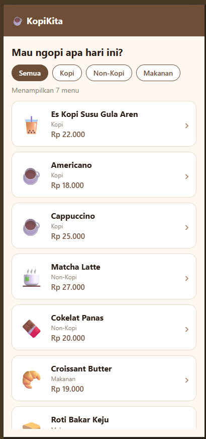

# KopiKita — Aplikasi Pemesanan Kopi

Tugas Pertemuan 3: interaction, navigation, Stack Navigation, dan passing data menggunakan React Native + Expo.

## Cara Menjalankan

```bash
npm install
npx expo start
```

Scan QR code dengan aplikasi **Expo Go** (Android/iOS).

## Struktur Project

```
kopikita/
├── App.js                      # NavigationContainer + Stack Navigator
└── src/
    ├── data/menu.js            # Data menu & kategori
    ├── utils/format.js         # Helper format Rupiah
    ├── theme.js                # Warna aplikasi
    └── screens/
        ├── HomeScreen.js       # Daftar menu + filter kategori
        ├── DetailScreen.js     # Detail menu, ukuran, jumlah
        └── CheckoutScreen.js   # Konfirmasi pesanan & pembayaran
```

## Alur Navigasi

```
Home  ──navigate('Detail', {nama, harga, kategori})──▶  Detail
Detail ──navigate('Checkout', {nama, harga, jumlah})──▶  Konfirmasi
Detail / Konfirmasi ──goBack()──▶ screen sebelumnya
Konfirmasi (sukses) ──navigate('Home')──▶ Home
```

## 1. Interaction (Pressable, TouchableOpacity, onPress)

| Komponen | Lokasi | Fungsi |
|---|---|---|
| `Pressable` | HomeScreen – chip kategori | `onPress={() => setKategoriAktif(kat)}` memfilter menu |
| `Pressable` | HomeScreen – kartu menu | `onPress={() => handlePilihMenu(item)}` membuka Detail; style berubah saat `pressed` |
| `TouchableOpacity` | DetailScreen – tombol − / + | Mengubah jumlah pesanan (min 1, maks 10) |
| `TouchableOpacity` | DetailScreen – pilihan ukuran | Regular / Large (+Rp 5.000) |
| `TouchableOpacity` | CheckoutScreen – metode bayar | Memilih Tunai / QRIS / Transfer Bank |
| `TouchableOpacity` | CheckoutScreen – Konfirmasi | Validasi lalu menampilkan layar sukses |

## 2. Navigation (Stack Navigation)

Didefinisikan di `App.js` menggunakan `@react-navigation/native-stack`:

```js
const Stack = createNativeStackNavigator();

<NavigationContainer>
  <Stack.Navigator initialRouteName="Home">
    <Stack.Screen name="Home" component={HomeScreen} />
    <Stack.Screen name="Detail" component={DetailScreen} />
    <Stack.Screen name="Checkout" component={CheckoutScreen} />
  </Stack.Navigator>
</NavigationContainer>
```

- `navigation.navigate()` — berpindah ke screen berikutnya sambil mengirim data.
- `navigation.goBack()` — tombol **"← Kembali ke Menu"** (Detail) dan **"← Ubah Pesanan"** (Konfirmasi).

## 3. Passing Data & route.params

**Home → Detail** (`HomeScreen.js`):

```js
navigation.navigate('Detail', {
  nama: item.nama,
  harga: item.harga,
  kategori: item.kategori,
  emoji: item.emoji,
  deskripsi: item.deskripsi,
});
```

Diterima di `DetailScreen.js`:

```js
const { nama, harga, kategori, emoji, deskripsi } = route.params;
```

**Detail → Konfirmasi** (`DetailScreen.js`):

```js
navigation.navigate('Checkout', {
  nama,
  harga: hargaSatuan,
  jumlah,
  ukuran: ukuran.label,
  emoji,
});
```

Diterima di `CheckoutScreen.js`:

```js
const { nama, harga, jumlah, ukuran, emoji } = route.params;
```

## 4. useState

| Screen | State | Kegunaan |
|---|---|---|
| Home | `kategoriAktif` | Filter menu berdasarkan kategori |
| Detail | `jumlah` | Jumlah item yang dipesan |
| Detail | `ukuran` | Ukuran minuman (mempengaruhi harga) |
| Detail | `feedback` | Pesan setelah interaksi |
| Checkout | `metode` | Metode pembayaran terpilih |
| Checkout | `sudahDipesan` | Menampilkan layar sukses |
| Checkout | `feedback` | Pesan peringatan / konfirmasi |

## 5. Feedback ke Pengguna

- Kartu menu & chip berubah warna/skala saat ditekan (`pressed`).
- Detail: pesan hijau seperti *"➕ Jumlah ditambah menjadi 3"*, peringatan *"⚠️ Minimal pemesanan 1 item"*, subtotal ter-update otomatis.
- Konfirmasi: peringatan *"⚠️ Pilih metode pembayaran terlebih dahulu"* jika belum memilih, lalu layar **"✅ Pesanan Berhasil!"** setelah konfirmasi.

## Screenshot

| Home | Detail | Konfirmasi | Sukses |
|---|---|---|---|
|  |  |  |  |
